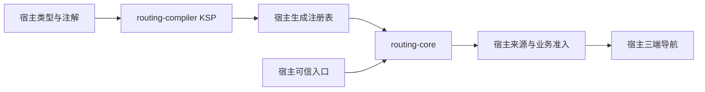
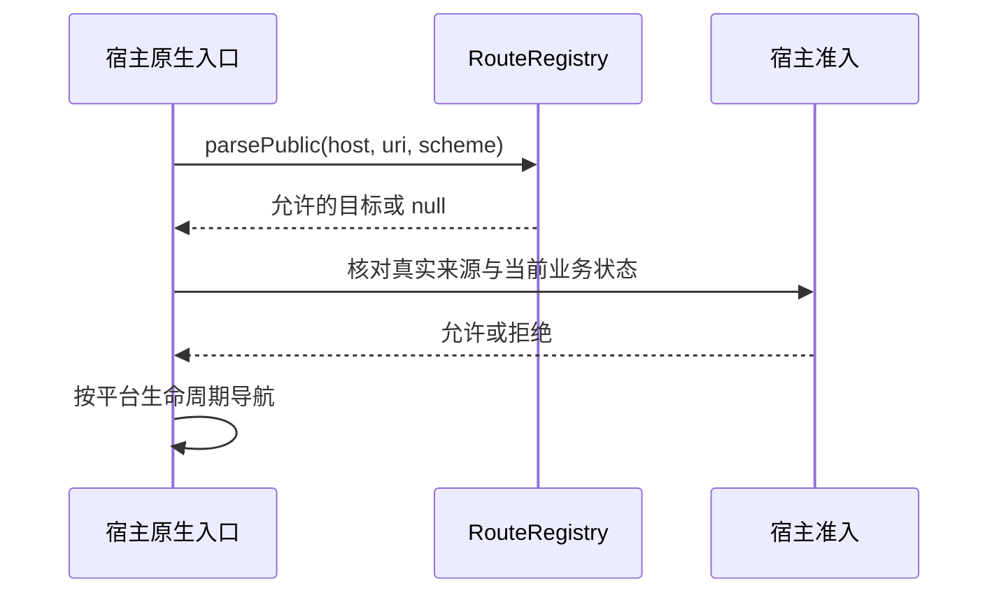
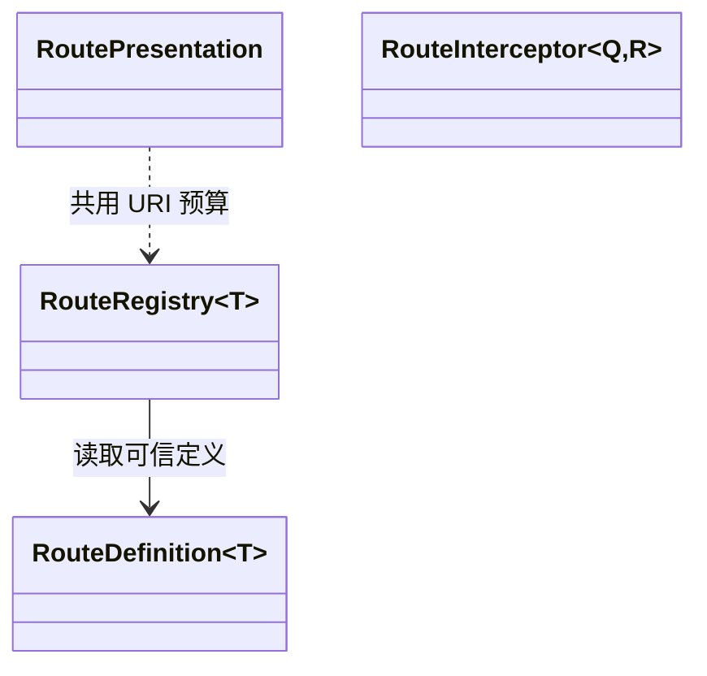

# Routing

提供跨平台声明式路由的通用注册、URI/JSON 信封校验、展示参数、拦截链与 KSP 生成器。`routing-core` 和 JVM `routing-compiler` 不持有业务目的地、品牌 Scheme、登录状态或页面 UI，也没有 Kuikly Module。宿主声明自己的类型和注解，并负责来源认证、业务准入与原生导航。

当前为 **0.1.0-rc.1 未发布候选**，不能视为已可从 JitPack 下载。完整合同见[功能与平台差异](docs/功能与平台差异.md)，命令与验证边界见[开发与验证](docs/开发与验证.md)。

## 架构与调用流程



KSP 在构建期验证声明并生成宿主 actual 注册表；运行时解析通用参数，宿主保留最终授权。



[`RouteRegistry`](routing-core/src/commonMain/kotlin/com/dgtang/live/routing/RouteRegistry.kt) 消费可信 [`RouteDefinition`](routing-core/src/commonMain/kotlin/com/dgtang/live/routing/RouteDefinition.kt)；[`RouteRegistrySpec` / `PageRegistrySpec`](routing-core/src/commonMain/kotlin/com/dgtang/live/routing/RouteRegistrySpec.kt) 配置生成器，不引用具体宿主包名。



## 安装与最小使用

发布完成后的预期坐标（当前未发布）：

```kotlin
repositories { maven("https://jitpack.io") }
commonMain.dependencies {
    implementation("com.github.gycrosskit.routing:routing-core:0.1.0-rc.1")
}
// 按实际目标启用 KSP；纯运行时消费可不安装 compiler。
dependencies {
    listOf("Android", "IosArm64", "IosSimulatorArm64", "IosX64", "OhosArm64").forEach {
        add("ksp$it", "com.github.gycrosskit.routing:routing-compiler:0.1.0-rc.1")
    }
}
```

工具链保持宿主基线：Kotlin `2.2.21-1.0.0`、KSP `2.2.21-2.0.4`、AGP `8.10.1`、Gradle `8.11.1`、Ktor HTTP `3.3.3-1.1.0-04`、coroutines `1.10.2-1.0.0`、serialization `1.9.1-1.0.0`。core Android compileSdk 36 / minSdk 24 / JVM 11；另有 JVM 11、iOS arm64/Simulator arm64/x64、OHOS arm64。**compiler 维持 JVM 21，构建/KSP 宿主需 JDK 21**；它不进入手机运行时。iOS 最低版本随实际 Native 产物与宿主核验。没有单独 SPM、Pod、HAR 或 ohpm 包。

```kotlin
import com.dgtang.live.routing.RouteRegistry

// definitions 来自宿主可信声明或 KSP 表；不要从外部 JSON 构造定义。
val registry = RouteRegistry(definitions = hostDefinitions, normalize = hostNormalize)
val target = registry.parsePublic("links.example.test", incomingUri, scheme = brandScheme)
if (target != null && hostAdmissionAllows(target)) {
    hostNavigator.open(target)
}
```

可编译的完整第二宿主示例在 [verification-consumer](verification-consumer/src/commonMain/kotlin/Probe.kt)：它声明自己的注解、目标、包装字段、访问枚举和页面入口，独立从 Maven 解析 core 与 compiler，并断言生成表可实际使用。

`PUBLIC` 才能从公开 URI 进入；`RENDERER` 仅开放由宿主确认可信的信封；`INTERNAL` 仅供内部协议。`decodePublicTarget` **不提供来源认证**，`parseInternal` 不能由不可信外链调用。真实 frame、窗口 owner、Intent/Universal Link/Want 生命周期、登录/品牌/功能准入留在宿主；通过解析不等于获准导航。

包名保持 `com.dgtang.live.routing`，生成器包为 `com.dgtang.live.routing.compiler`。宿主路由和页面源码扫描检查器及对应验证 task 留在宿主，组件保留通用生成器测试。

## 验证与反馈

保留 core 的 URI/信封/预算、展示、拦截器取消与重复放行保护，以及 compiler 的声明校验、跨轮聚合和第二宿主生成/执行回归。独立消费者覆盖 Maven core + KSP JAR。**本候选尚未执行 SDK 编译、回归、Native 链接、公开坐标消费或设备验收**，轻量脚本检查不等同于这些结果。

发行入口：[Releases](https://github.com/gycrosskit/routing/releases)（当前候选未发布）。问题反馈请通过 [Issues](https://github.com/gycrosskit/routing/issues) 提供脱敏输入、精确版本和失败时序。源码抽离自宿主 `c768cb12c86e59b60fbc69149013850edce509b0`，许可证为 [Apache-2.0](LICENSE)。
